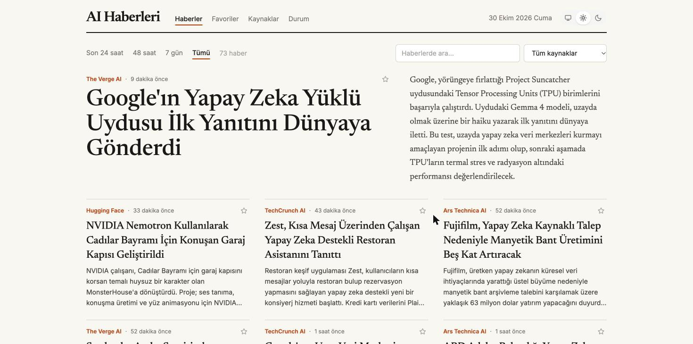
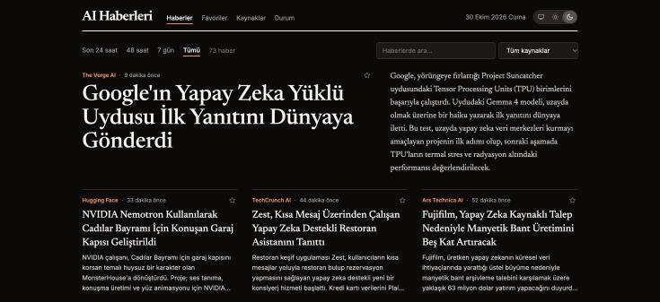
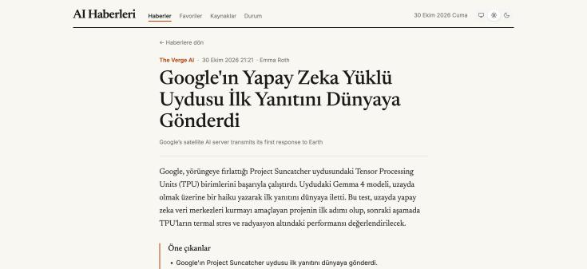
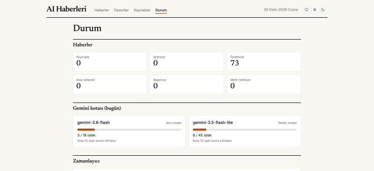
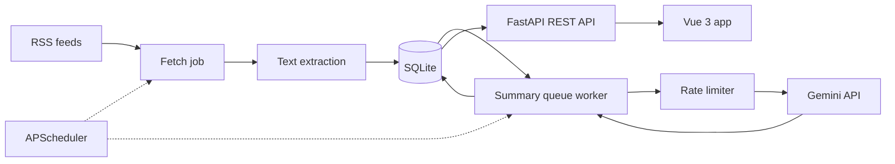

# AI News

A self-hosted news reader that collects AI news from RSS feeds and summarizes long articles in Turkish with the Gemini API, using a rate-limited queue stored in the database.



| Dark theme | Article page | Status dashboard |
| --- | --- | --- |
|  |  |  |

> **Note:** This is a personal project that runs locally; it is not a hosted service. The UI shows summaries with a link to the original source, and the extracted full text is deleted once an article has been processed. Before running it publicly, review each source's terms of use.

## Features

- **Scheduled collection:** fetches RSS/Atom feeds hourly, with URL deduplication and `ETag` / `Last-Modified` support.
- **Full-text extraction:** uses trafilatura, and falls back to the feed text when a page is unavailable.
- **Turkish summaries:** batched structured output from Gemini, with a title, a summary and key points.
- **Quota-aware queue:** per-minute and daily limits, backoff, crash recovery and a fallback model.
- **Reader UI:** lead story and grid layout, time and source filters, Turkish-aware search, favorites, and light and dark themes.
- **Admin tools:** feed management, re-summarizing and a status dashboard, protected by an admin key.

## Architecture



Data flows one way: collect, extract, queue, summarize, serve. Each stage reads the previous stage's output from the database, so a failed stage does not block the others and the app resumes where it stopped after a restart.

## Design Decisions

- **The database is the queue.** `Article.summary_status` with `next_attempt_at` replaces Redis or Celery. At this volume it needs no extra service, survives restarts and is easy to inspect.
- **Service errors are not article errors.** A 429, 5xx or timeout pauses the model and switches to the fallback; only problems caused by the article itself count as attempts.
- **Batch requests.** Sending several articles in one request gets more out of a small daily quota. Articles that failed before are retried alone, so one bad article cannot block a batch.
- **Full text is temporary.** It is kept only while an article waits for a summary and is then deleted, with SQLite `secure_delete` enabled. Re-summarizing downloads it again.
- **Turkish-aware search.** A `search_fold()` SQL function folds I/İ/ı and accents, so a query matches both Turkish and English text.
- **Limits are configuration.** Rate limits, thresholds and model names come from settings, because free-tier quotas change.

## Tech Stack

- **Backend:** Python 3.13, FastAPI, SQLModel, SQLite, Alembic, APScheduler, feedparser, trafilatura, google-genai
- **Frontend:** Vue 3, TypeScript, Vite, Pinia, Vue Router, Tailwind CSS
- **Tooling:** uv, Ruff, pytest, Vitest, ESLint, oxlint, Prettier, GitHub Actions

## Getting Started

Requires [uv](https://docs.astral.sh/uv/), Node.js ^22.18, npm 11 and a [Gemini API key](https://ai.google.dev/).

**Backend**

```bash
cd backend
cp .env.example .env      # set GEMINI_API_KEY and ADMIN_API_KEY
uv sync
uv run fastapi dev        # http://localhost:8000/docs
```

Migrations run on startup, and `sources.yaml` seeds the feeds into an empty database. Run only one app process per database, because each process starts its own scheduler. Set `SCHEDULER_ENABLED=false` for API-only runs.

**Frontend**

```bash
cd frontend
npm install
npm run dev               # http://localhost:5173
```

Enter the value of `ADMIN_API_KEY` on the Kaynaklar (Sources) page to unlock feed management and the status dashboard.

## Testing

```bash
# backend
uv run pytest
uv run ruff check . && uv run ruff format --check .

# frontend
npx vitest run
npm run lint:check && npm run format:check && npm run type-check && npm run build
```

Tests use fake summarizers, local fixtures and in-memory SQLite, so they never call Gemini or real feeds. CI runs all of these checks on every push to `main` and on pull requests, and needs no secrets.

## Project Structure

```text
backend/
├── app/
│   ├── api/          # REST endpoints
│   ├── services/     # fetching, extraction, summarizing, queue, rate limiter
│   ├── models.py     # database tables
│   └── scheduler.py  # background jobs
├── migrations/       # Alembic migrations
├── scripts/          # manual fetch and summary tools
├── tests/
└── sources.yaml      # initial feed list
frontend/src/
├── api/              # typed API client
├── components/
├── stores/           # Pinia stores
└── views/            # lazy-loaded pages
docs/PLAN.md          # architecture and roadmap (in Turkish)
```
